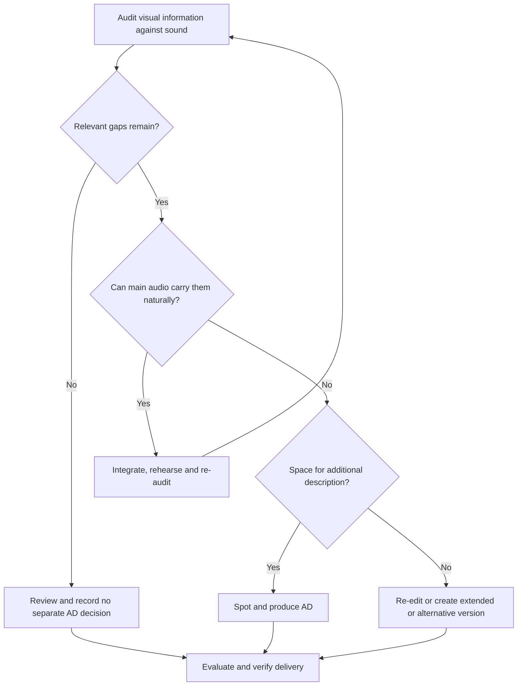

# 1. Decide how the content will work through sound

[Repository home](../README.md) · [Source register](08-sources-and-editorial-decisions.md)

## Make the decision before filming, then verify it after editing

An audio-first approach means designing a coherent listening experience and filming it. Integrated description means deliberately putting relevant visual information into the main speech or narration. They overlap, but are not identical: an ordinary interview may already communicate everything necessary, while a demonstration may need carefully scripted explanation of actions.

A separate AD track adds a descriptive voice to the original programme. An extended described version creates additional time for description. A hybrid uses integrated description for most content and separate AD for remaining visual information. None is inherently the right choice for every production.

## Decision table

| Question | Decision or next action | Evidence |
|---|---|---|
| Does the picture convey information, action, meaning or experience unavailable through sound? | If no, extra description may be unnecessary. Confirm against the whole edit. | Visual audit and listening review |
| Can that content be communicated naturally in the main soundtrack? | Plan audio-first or integrated description. | Marked script and rehearsal |
| Does the final soundtrack cover it without artificial dialogue or excessive explanation? | If yes, approve no separate AD, with a version-specific reason. | Audit, independent review and approval |
| Are there remaining visual gaps with usable spaces in the audio? | Add separate AD, possibly as a hybrid. | Spotted cues and protected sound map |
| Are gaps too dense for clear description? | Re-edit, make an extended described version, or commission an alternative descriptive commentary. | Approved route and supported delivery method |
| Is the programme live? | Design coordinated integrated commentary or a separately mixed descriptive service, with rehearsal and recovery arrangements. | Running order, cue protocol and live technical test |
| Does the selected platform support the route? | Verify the actual player. Where needed, supply a clearly linked described video. | Published playback test |

## Audit more than plot and facts

Check speaker names and roles; silent entrances and departures; gestures that change the meaning of a response; demonstrations; charts and maps; dates and disclaimers; messages and translations; jokes; visual evidence; changes in place or time; and the visual texture that shapes mood or enjoyment. A listener may follow the conversation yet miss that a participant leaves in protest. That is a meaningful gap.

Distinguish information already communicated from information that a sighted reviewer merely remembers seeing. Ask a reviewer who has not watched the piece to explain it after listening. Then compare their understanding with the visual audit. A sighted team member closing their eyes is useful rehearsal, but does not substitute for blind and partially sighted audience expertise.

## Record a positive, bounded decision

Use the [release record](../templates/release-and-decision-record.md) to name the programme, cut, language, platform, reviewers and evidence. For an approved audio-first presentation, a public label could say: “All information needed to follow this presentation is included in the main soundtrack.” Avoid claiming the whole production is accessible on the strength of this decision alone.

Reassess when editing introduces a graph, removes an introduction, changes a reveal, replaces a demonstration, adds a visual-only call to action or creates a short social cut. An approval for the full programme does not automatically cover a trailer.

## Decisions that are not sufficient

- “It is mostly talking.” Check the remaining visual material.
- “There is no room.” Change the treatment or route; limited space is a production problem.
- “The transcript explains it.” Text access has value, but does not provide the same synchronised listening experience.
- “The topic is too visual.” Explore another descriptive treatment with the audience.
- “Radio listeners manage.” Establish what this soundtrack actually communicates.

Foundation: [S01, S03, S04, S05](08-sources-and-editorial-decisions.md). The audit and approval method is this repository's operational recommendation.
